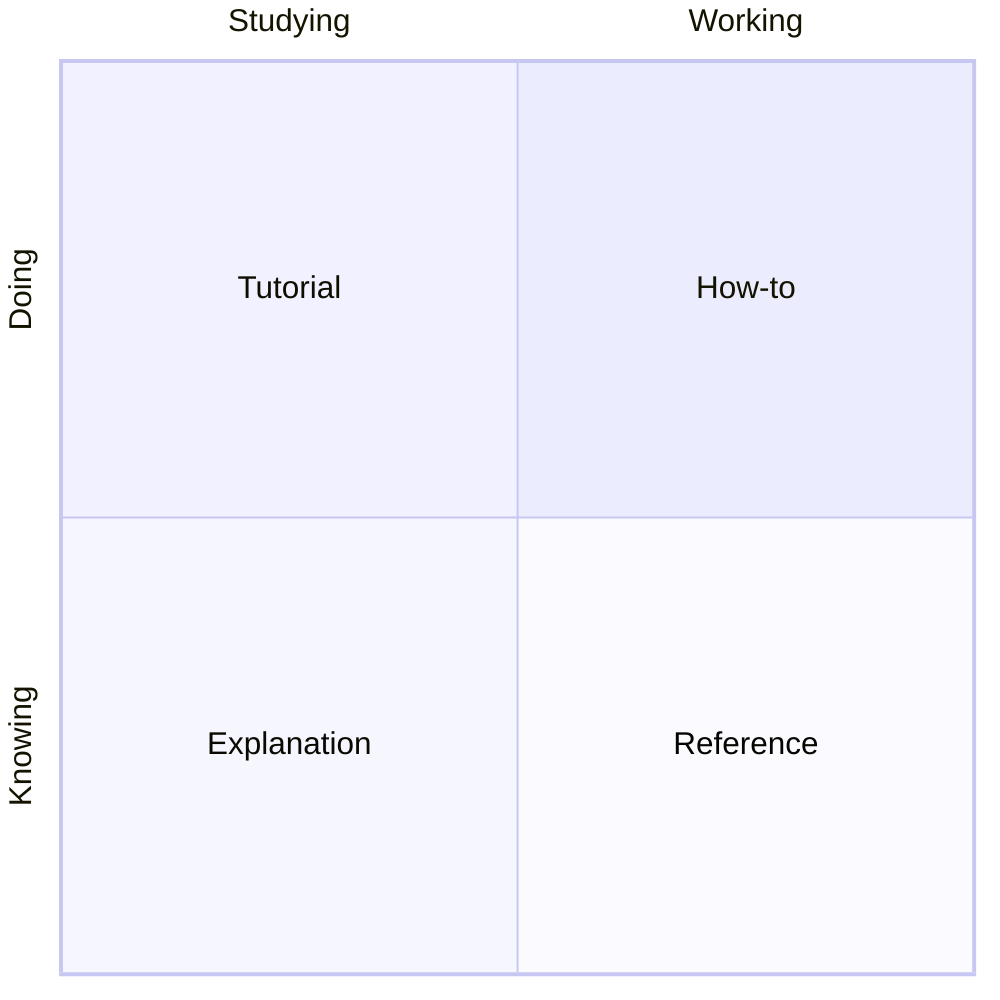

# 💡 Explanation: why docs need a compass

[📚 Docs home](../../../../docs/README.md) › [🧭 doc-compass](README.md) ›
[🚀 Tutorial](tutorial.md) · [🛠️ How-to](how-to.md) · [📖 Reference](reference.md) · **💡
Explanation**

Why the skill works the way it does. To get something done, see the [How-to guides](how-to.md).

## Every reader arrives with one need

[Diataxis](https://diataxis.fr/) sorts documentation by what the reader is doing, not by topic. Two
questions place any page: is the reader doing or understanding, and are they studying or at work?

A page that answers two needs makes both readers read past the half they did not come for. That is
why the skill splits such pages rather than adding headings to them.

## Docs rot by omission, not by mistake

The docs this skill was built from were written with care. They went stale because a page was added
and the index was not, a heading was renamed and its links were not, a decision was reversed and the
old record still read as current. Each is something nobody did. The check looks for exactly these,
because they are the ones a careful writer misses.

## Why seven rules, and why these

Each rule stands for a failure seen in a real docs set, written up in the skill's
[`evidence.md`](../../skills/doc-compass/evidence.md). A rule nobody has paid for would pass on
every project and prove nothing. What a script cannot see, such as a tutorial with a fork in it or a
number written from memory, stays in `guards.md` as guidance, until someone finds a way to check it.

## Rewrite, never annotate

A page that carries "Updated in v3" callouts asks the reader to merge two versions in their head.
The skill rewrites the page to say what is true now, and keeps history where readers look for it:
the CHANGELOG for what changed, and decision records for why.

## Gravestones instead of deletions

Deleting a cited page breaks every citation at once, often in places the docs cannot see, such as
code comments. A gravestone costs one short page and keeps every pointer working, so it is the
default whenever something cites the old path.

## Why the docs live outside the skill

The skill folder is loaded by the model on every call; these pages are read by people. Keeping them
apart means neither pays for the other's text, the same choice
[hexagonal-skill-builder](../hexagonal-skill-builder/explanation.md) makes.
