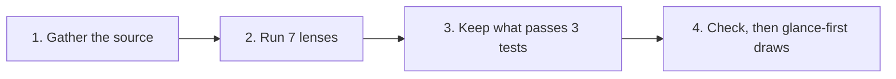

# 🔍 glance-audit

[📚 Docs home](../../../../docs/README.md) › [arnaud-zg](../../README.md) › **🔍 glance-audit**

A skill that reads a document, plan, pull request or status report like a careful sceptic,
challenges its claims and finds the points worth discussing. It hands back a one-line verdict, the
critical finding with its proof, and comments anchored on exact quotes, ready to paste. A script
checks the result against the source before [glance-first](../glance-first/README.md) draws it.

**7 lenses** · **3 tests** · **3 sources** · **0 posts**

## At a glance

- **What is it?** An audit Claude writes as a JSON result, checks against the source text, then
  hands to glance-first to render
- **What does it read?** A document, a pull request, or a status report
- **How do I install it?** `/plugin install arnaud-zg --marketplace arnaud-zg/skills`, or
  `npx skills add arnaud-zg/skills --skill glance-audit` for any agent
- **How do I call it?** Ask Claude to _audit this_, _challenge this plan_, _poke holes_ or _play
  devil's advocate_, or type `/arnaud-zg:glance-audit`
- **What does it need?** Node 22 for the check. No network, no dependency

## Which page do I need?

| If you want to…                   | Go to                            | It gives you                              |
| --------------------------------- | -------------------------------- | ----------------------------------------- |
| audit a first document            | 🚀 [Tutorial](tutorial.md)       | a plan turned into a checked verdict      |
| audit a pull request, a status    | 🛠️ [How-to guides](how-to.md)    | one recipe per source and target          |
| look up the fields and the rules  | 📖 [Reference](reference.md)     | every field, limit, group and exit code   |
| understand why it keeps so little | 💡 [Explanation](explanation.md) | why three tests, one lead, and no posting |

## 🔒 Know what you're installing

- **The check reads two files and writes nothing.** `scripts/check-audit.mjs` reads the result and
  the source text you point it at and prints its findings. No network, no dependency.
- **It never posts.** It never comments, approves, edits or sends anything in the source; pasting
  the drafted comments is yours to do.

Read [`SKILL.md`](../../skills/glance-audit/SKILL.md) before installing it. Claude reads `SKILL.md`,
not this page.
