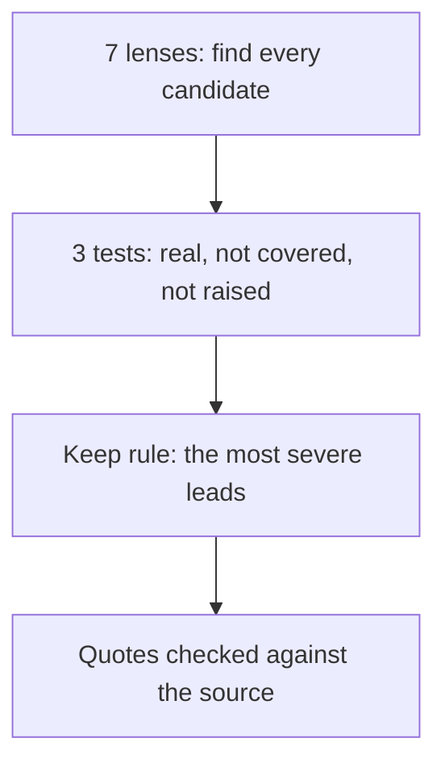

# 💡 Explanation: why an audit keeps so little

[📚 Docs home](../../../../docs/README.md) › [🔍 glance-audit](README.md) ›
[🚀 Tutorial](tutorial.md) · [🛠️ How-to](how-to.md) · [📖 Reference](reference.md) · **💡
Explanation**

Why the skill works the way it does. To get something done, see the [How-to guides](how-to.md).

**A reviewer is trusted for what they leave out: one critical point beats ten fair ones.**

## Many lenses, few findings

Seven lenses look everywhere so nothing is missed; most find nothing. The three tests then drop the
hunch, the point the source already answers, and the point a reviewer already made, credited instead
of repeated.

## One point leads

A list of equals makes the reader rank it. So every critical point is kept, and otherwise only the
most severe; the rest is folded as _can wait_, never lost. Nothing is rated up to fill the page.

## A quote the reader can place

A comment is pasted on a passage, so its quote must be that passage, word for word, and occur once.
The check holds it against the source text, never the context, so a comment always has an anchor.

## It judges; others render and post

The judgement is the skill's, the form is [glance-first](../glance-first/README.md)'s, and posting
is the reader's. Keeping those apart is what lets it read a pull request without ever touching it.

doc-compass audits a doc set's structure; glance-audit challenges what one source claims.
