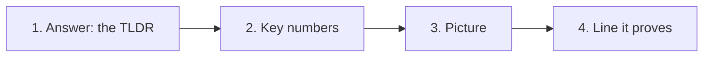

# 👁️ glance-first

[📚 Docs home](../../../../docs/README.md) › [arnaud-zg](../../README.md) › **👁️ glance-first**

A skill that presents any piece of work so a reader gets the key information in under one minute.
The answer comes first, then the key numbers, then at most four blocks that each open on a diagram,
chart, table or screenshot marking what changed. A script checks the brief before anything is drawn.

**Under 1 minute** · **200 words max** · **4 blocks max** · **4 targets**

## At a glance

- **What is it?** A one-minute format Claude writes as a JSON brief, checks with a script, then
  draws for the place you name
- **Where does it draw?** An artifact page, a pull request description, the terminal, or a Markdown
  file
- **How do I install it?** `/plugin install arnaud-zg --marketplace arnaud-zg/skills`, or
  `npx skills add arnaud-zg/skills --skill glance-first` for any agent
- **How do I call it?** Ask Claude for a _TLDR_, to _write the PR description_ or to _present this_,
  or type `/arnaud-zg:glance-first`
- **What does it need?** Node 22 for the check. No network, no dependency

## Which page do I need?

| If you want to…                    | Go to                            | It gives you                             |
| ---------------------------------- | -------------------------------- | ---------------------------------------- |
| present a first change             | 🚀 [Tutorial](tutorial.md)       | a diff turned into a one-minute brief    |
| write a PR body, a page, a file    | 🛠️ [How-to guides](how-to.md)    | one recipe per target                    |
| look up the fields and the limits  | 📖 [Reference](reference.md)     | every field, limit and finding           |
| understand why numbers come second | 💡 [Explanation](explanation.md) | why the eye goes answer, figure, picture |

## 🔒 Know what you're installing

- **The check reads one file and writes nothing.** `scripts/check-brief.mjs` reads the brief you
  point it at and prints its findings. No network, no dependency.
- **It never posts.** A pull request body is printed or written to a file you name; posting it is
  yours to do.

Read [`SKILL.md`](../../skills/glance-first/SKILL.md) before installing it. Claude reads `SKILL.md`,
not this page.
