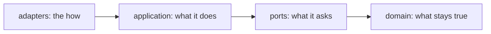

# ⬡ hexagonal-architecture

[📚 Docs home](../../../../docs/README.md) › [arnaud-zg](../../README.md) › **⬡
hexagonal-architecture**

A skill that designs, audits and refactors code and Agent Skills by hexagonal architecture (ports
and adapters, clean architecture): every dependency points inward, from adapters to the domain. A
script reads imports and Markdown links and flags each one that points outward. It also holds the
one port and adapter contract every other skill in this plugin follows.

**4 layers** · **1 rule** · **3 verbs** · **4 languages read** · **0 writes by the check**

## At a glance

- **What is it?** Three verbs, design, audit and refactor, a check, and the shared port contract
- **When is it used?** When code or a skill should keep its core free of tools: _decouple this from
  the database_, _where should this code go_, _use clean architecture_
- **How do I install it?** `/plugin install arnaud-zg --marketplace arnaud-zg/skills`, or
  `npx skills add arnaud-zg/skills --skill hexagonal-architecture`
- **How do I call it?** Ask Claude to _use hexagonal architecture_, or type
  `/arnaud-zg:hexagonal-architecture`
- **What does it need?** Node 22 for the check. No network, no dependency

## Which page do I need?

| If you want to…                     | Go to                            | It gives you                            |
| ----------------------------------- | -------------------------------- | --------------------------------------- |
| see the check catch a leak          | 🚀 [Tutorial](tutorial.md)       | a leak found, then gone                 |
| design, audit, refactor, add a port | 🛠️ [How-to guides](how-to.md)    | one recipe per task                     |
| look up the layers, the contract    | 📖 [Reference](reference.md)     | folder names, keys, binding, exit codes |
| understand why the core owns ports  | 💡 [Explanation](explanation.md) | why inward, and why skills are hexagons |

## 🔒 Know what you're installing

The check reads source and Markdown files under one folder and prints its findings. It writes
nothing, and has no network and no dependency. Read
[`SKILL.md`](../../skills/hexagonal-architecture/SKILL.md) before installing it.
