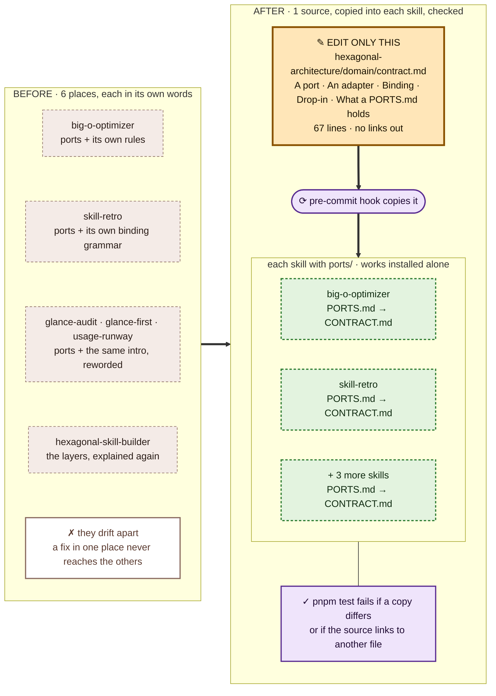

# 💡 Explanation: why every dependency points inward

[📚 Docs home](../../../../docs/README.md) › [⬡ hexagonal-architecture](README.md) ›
[🚀 Tutorial](tutorial.md) · [🛠️ How-to](how-to.md) · [📖 Reference](reference.md) · **💡
Explanation**

Why the skill works the way it does. To get something done, see the [How-to guides](how-to.md).

## The core changes for business reasons, the edges for technical ones

A price rule changes when the business does; a database driver changes when a vendor does. Pointing
every dependency inward keeps the second kind of change at the edge.

## The core owns its ports

A port is written in the core's words, for the core's need. An interface shaped like its first
adapter only moves the coupling one file over.

## Hexagonal, clean, onion: one rule

The names differ in how many rings they draw. The rule they share is the one the check holds.

## A skill is a hexagon too

A skill's verbs are its use cases, its domain pages what stays true, its adapters the tools it
touches. A domain page that links a tool's page leaks the same way an import does, so the check
reads links too.

## One contract, said once

Five skills in this plugin have ports. Each used to explain ports, bindings and drop-ins in its own
words, and the words drifted. The contract now lives in this skill, and each ports page keeps only
its own ports.

Every skill with ports carries an exact copy of the contract, so it keeps its rules however it is
installed: an agent only ever reads a skill's own folder. The source is the one file to edit; the
pre-commit hook rewrites the copies, and `pnpm test` fails if one differs. The source links to no
other file, because each copy lives in a different folder.
