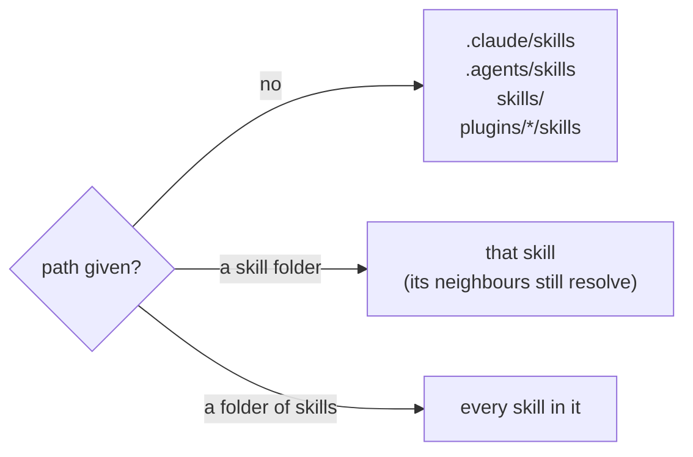

# 📖 Reference: hexagonal-skill-builder command, exit codes and rules

[📚 Docs home](../../../../docs/README.md) › [🧩 hexagonal-skill-builder](README.md) ›
[🚀 Tutorial](tutorial.md) · [🛠️ How-to](how-to.md) · **📖 Reference** ·
[💡 Explanation](explanation.md)

What the check reads, what it looks for, and what it prints.

## Command

```text
node scripts/check.mjs [path ...] [--suite <script>] [--json]
```

- `path`: a folder of skills, or one skill's folder; several are allowed
- `--suite <name>`: also require every test to be named in that `package.json` script
- `--json`: print the result as JSON instead of text
- `-h`, `--help`: print the usage

- `0`: every skill holds all four rules
- `1`: at least one finding
- `2`: nothing to check: no skills, a path that does not exist, a bad option

Colour is on in a terminal, and off in a pipe or when `NO_COLOR` is set. `FORCE_COLOR=1` turns it
on.

## Project adapters

```text
node scripts/check.mjs --adapters [root] [--skills <folder>] [--json]
node scripts/migrate-adapters.mjs [root] [--skill <name> ...] [--write] [--json]
```

`--adapters` checks the files in `.agents/adapters/<skill>/` under the root (the repository's top
folder when left out) instead of skills; dotfiles and READMEs beside them are skipped. `--skills`
adds a folder of skills an adapter may be for; the shelf this skill is installed on is always read.
Exit `0` clean, `1` on a finding, `2` when the project has no adapters at all.

| Check     | Fails when                                                              |
| --------- | ----------------------------------------------------------------------- |
| `name`    | a file is not `<skill>/<port>.<name>.md`                                |
| `fulfils` | its frontmatter has no `fulfils`, or names another port                 |
| `skill`   | its folder names no skill found here                                    |
| `port`    | its port is not a row of the skill's `ports/PORTS.md`                   |
| `one`     | a port with count `1` and default `none` has several files              |
| `legacy`  | a `.<skill>/adapters/` folder of an installed skill is left at the root |

`migrate-adapters.mjs` prints the plan and writes nothing without `--write`. It takes a
`.<x>/adapters/` folder only when `x` is an installed skill or its old alias, or is named with
`--skill`, and moves only `<port>.<name>.md` files; anything else is left in place and listed. With
it, it moves each legacy file by `git mv`, rewrites the old folder's mentions in tracked text files,
and removes the emptied folders. `--skill <name>` limits it to that skill's folder, for a project
that moves one skill at a time. Exit `1` when a different file already sits at a target; nothing is
written then.

## Where it looks



A skill is a folder with a `SKILL.md`. Links are followed. `node_modules`, `.git` and files over 1
MB are skipped.

## The rules

- `named`: no frontmatter; `name` not the folder's; a name not lowercase-hyphen words (limit: 64
  characters)
- : no `description`; a description without "use" or "when"; a description too long (limit: 1024
  characters)
- `small`: a `SKILL.md` body (frontmatter not counted) over the limit (limit: 150 lines)
- : any other `.md` page over the limit (limit: 300 lines)
- `resolves`: a pointer to a file or heading that does not exist (see below) (limit: )
- : a cited story `E-NN` with no `## E-NN` heading or `**E-NN**` in `evidence.md` (limit: )
- `tested`: a script under `scripts/` that no test names (limit: )
- : with `--suite`: a test the suite script does not name (limit: )

### What counts as a pointer

- `[text](page.md)`, `[text](dir/)`: from the page's own folder
- `[text](page.md#heading)`, `[text](#heading)`: the heading, by its GitHub anchor
- `[text](../other-skill/page.md)`: in the neighbouring skill
- `${CLAUDE_SKILL_DIR}/scripts/run.mjs`: from the skill's root, even inside a code block
- `scripts/run.mjs` in prose: only when the skill has a `scripts/` folder
- a URL, `mailto:`, `/absolute`, `../../…`: never: it belongs to the web or to the project
- anything in a code block or in `` `[inline](code)` ``: never: it is an example

### What counts as a script and a test

- script: `scripts/**` ending `.js`, `.mjs`, `.cjs`, `.ts`, `.mts`, `.cts`, `.py`, `.sh`
- test: `*.test.*`, `*.spec.*` (JS or TS), `test_*.py`, `*_test.py`

A test reaches a script when it names its file, its quoted name, or imports it in Python. A script a
reached script names is reached too.

## JSON output

```json
{
  "skills": [{ "name": "release-notes", "path": ".claude/skills/release-notes" }],
  "findings": [
    {
      "skill": "release-notes",
      "rule": "resolves",
      "file": "SKILL.md",
      "line": 8,
      "message": "format.md does not exist",
      "fix": "point at where it lives now, or remove the pointer",
      "path": ".claude/skills/release-notes/SKILL.md"
    }
  ]
}
```

## Files

- `SKILL.md`: the entry: the rules, the check, how to create a skill (read by: Claude)
- `guards.md`: seven mistakes no script can see (read by: Claude)
- `evidence.md`: the story behind each rule and guard (read by: Claude)
- `scripts/check.mjs`: the command line (read by: Node)
- `scripts/rules.mjs`: the four rules, pure functions (read by: Node)
- `scripts/shelf.mjs`: finds and reads skills on disk (read by: Node)
- `docs/`, `README.md`: these pages (read by: people)

## Example

[`examples/hexagonal-skill-builder/release-notes/`](../../examples/hexagonal-skill-builder/release-notes/SKILL.md):
a skill that holds all four rules.
[`examples.integration.test.ts`](../../examples/examples.integration.test.ts) runs it.
