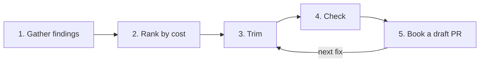

# 🔁 skill-retro

[📚 Docs home](../../../../docs/README.md) › [arnaud-zg](../../README.md) › **🔁 skill-retro**

A skill that finds what made a session's skills slow, wrong or expensive in tokens, ranks it by
cost, trims each skill and books every fix as its own draft pull request in a skills stack beside
the feature stack.

**5 steps** · **3 ports** · **8 adapters** · **1 draft PR per fix**

## At a glance

- **What is it?** An end-of-session retro that turns friction with evidence into small, checked
  fixes to the skills themselves
- **Where do fixes go?** One draft pull request per fix, each on its own branch and worktree,
  stacked with `gh stack`
- **How do I install it?** `/plugin install arnaud-zg --marketplace arnaud-zg/skills`, or
  `npx skills add arnaud-zg/skills --skill skill-retro` for any agent
- **How do I call it?** Say _retro_, _end of session_, _improve the skills_ or _too many tokens_, or
  type `/arnaud-zg:skill-retro [<skill> ...] [--bind <binding>]`
- **What does it need?** Node for its scripts, `gh` with the `gh stack` extension, and
  [hexagonal-skill-builder](../hexagonal-skill-builder/README.md) for the shape check.
  `radical-simplify` is used when installed

## Which page do I need?

| If you want to…                     | Go to                            | It gives you                            |
| ----------------------------------- | -------------------------------- | --------------------------------------- |
| run a first retro                   | 🚀 [Tutorial](tutorial.md)       | one session turned into booked fixes    |
| bind other sources, retro one skill | 🛠️ [How-to guides](how-to.md)    | one recipe per task                     |
| look up ports, adapters and scripts | 📖 [Reference](reference.md)     | every binding, flag, exit and line      |
| understand why fixes never run live | 💡 [Explanation](explanation.md) | why evidence, cost and a separate stack |

## 🔒 Know what you're installing

- **It never edits the checkout that runs it.** Each fix is made in its own worktree and takes
  effect only after a person merges it.
- **It opens drafts only.** It never merges, force-pushes, opens a non-draft, or runs
  `gh stack sync` or `gh stack rebase`.
- **Its scripts read and print.** `weight.mjs`, `gaps.mjs` and `stack-base.mjs` write nothing. No
  dependency.

Read [`SKILL.md`](../../skills/skill-retro/SKILL.md) before installing it. Claude reads `SKILL.md`,
not this page.
