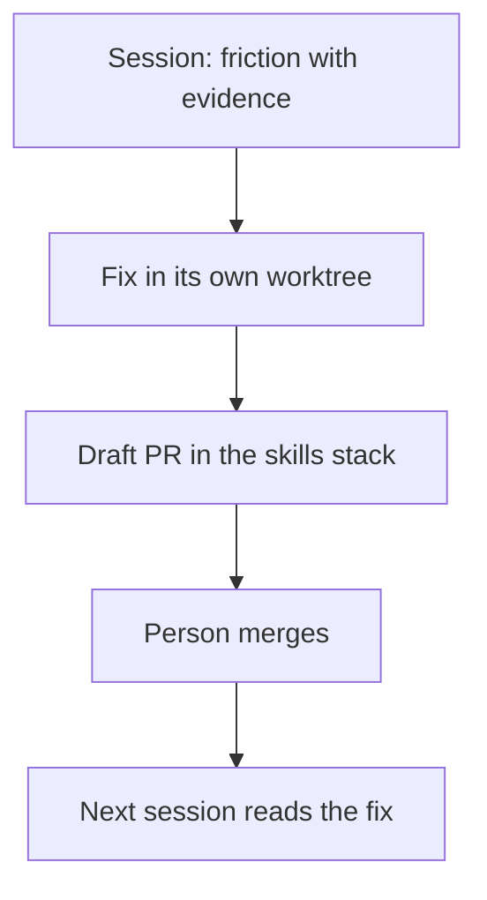

# 💡 Explanation: why fix the skills, and never live

[📚 Docs home](../../../../docs/README.md) › [🔁 skill-retro](README.md) ›
[🚀 Tutorial](tutorial.md) · [🛠️ How-to](how-to.md) · [📖 Reference](reference.md) · **💡
Explanation**

Why the skill works the way it does. To get something done, see the [How-to guides](how-to.md).

**A skill gets cheaper and truer only when its friction is fixed where the next session reads it.**

## A fix made in the running checkout changes the rules mid-game

The session that hit the friction is still running on the old text. So each fix goes to its own
branch and worktree, and lands only after a person merges it.

## No evidence, no fix

A guessed cause produces a guessed fix. Every finding carries a quote, an error line or a count
copied from a script, and one without is dropped.

## Tokens are paid at three rates

A description is paid every session, an entry body every session that fires the skill, another page
only when read. Text said twice is paid twice, so `weight.mjs` finds the repeats and the fix removes
before it adds.

## Skill fixes stack beside features, not inside them

A skill fix should wait for no feature, and no feature for a skill fix. Two parallel stacks keep
them apart, which is why `stack-base.mjs` refuses a skill branch based on a feature branch.

## Handoffs and deferred rows are opt-in

Not every session runs subagents or parks work, so the default reads only what every session has.
