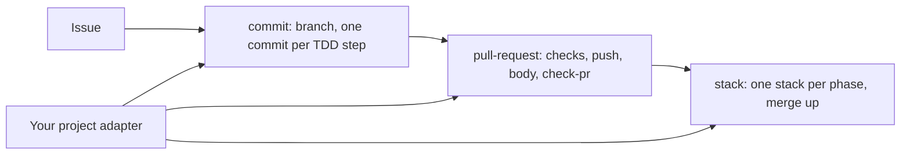

# 🚢 stack-and-ship

[📚 Docs home](../../../../docs/README.md) › [arnaud-zg](../../README.md) › **🚢 stack-and-ship**

A skill that ships a change from a branch to a stacked pull request by your project's house rules.
The rules cover branch and commit names that say the value and one commit per TDD step. They also
cover the checks before a push, a PR body a script checks, the board, and one stack per phase that
never force-pushes.

**3 verbs** · **1 project file** · **1 check script** · **0 force-pushes**



## At a glance

- **What is it?** The method for committing, opening PRs and stacking them, with your repository's
  commands, checks and PR rules kept in one file of yours
- **What does it check?**

  ```text
  title  → write `type(scope): [PHASE-ID] value`, scope a domain, subject lowercase (domain/messages.md)
  ticket  → keep `<!-- Ticket: acme/shop#<N> ... -->` commented
  ✗ 2 finding(s)
  ```

- **How do I install it?** `/plugin install arnaud-zg --marketplace arnaud-zg/skills`, or
  `npx skills add arnaud-zg/skills --skill stack-and-ship` for any agent
- **How do I call it?** Ask _ship this_, _open the PR_, _stack these PRs_, or type
  `/arnaud-zg:stack-and-ship`
- **What does it need?** Git, Node.js, and the GitHub CLI `gh` for the built-in forge and board
  adapters. One project adapter, `.agents/adapters/stack-and-ship/project.<name>.md`

## Which page do I need?

| If you want to…                          | Go to                            | It gives you                                 |
| ---------------------------------------- | -------------------------------- | -------------------------------------------- |
| ship a first PR with it                  | 🚀 [Tutorial](tutorial.md)       | a project adapter, then one checked PR       |
| add a rule, a forge or a stack           | 🛠️ [How-to guides](how-to.md)    | one recipe per task                          |
| look up the adapter's keys and the rules | 📖 [Reference](reference.md)     | every section, JSON key, rule and exit code  |
| understand why stacks never force-push   | 💡 [Explanation](explanation.md) | why merge up, why one file holds the project |

## 🔒 Know what you're installing

- **The check reads and writes nothing.** `scripts/check-pr.mjs` reads your project adapter and a
  body file, and prints findings. No network, no dependency.
- **The steps push and open PRs only when you approve it.** They ask before a push or a PR, never
  force-push, and never merge unless you ask for that merge.

Read [`SKILL.md`](../../skills/stack-and-ship/SKILL.md) before installing it. The agent reads
`SKILL.md`, not this page.
