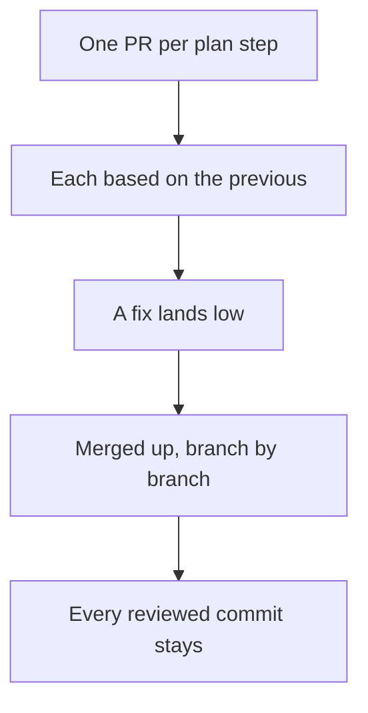

# 💡 Explanation: why one stack, merged up, never forced

[📚 Docs home](../../../../docs/README.md) › [🚢 stack-and-ship](README.md) ›
[🚀 Tutorial](tutorial.md) · [🛠️ How-to](how-to.md) · [📖 Reference](reference.md) · **💡
Explanation**

Why the skill works the way it does. To get something done, see the [How-to guides](how-to.md).

**A change is shipped when a reviewer can merge it without asking a question.**

## A force-push erases what a reviewer read

Rebasing a stack rewrites every branch above the fix, and a force-push replaces commits a reviewer
already commented on. Merging the lower branch up keeps them. The cost is a merge commit per branch,
which a squash merge removes at the end. So stacking tools whose submit command force-pushes are
used only for the calls that never push.

## One step, one pull request

A reviewer reads one plan step at a time, and the next step does not wait for that review: it
branches from the previous one. Small PRs merge bottom first, each one already read.

## The method is the skill's, the facts are the project's

Branch names, the TDD sequence and the stack rules hold in any repository. The commands, the checks,
the board ids and which lines a PR body must hold do not. They live in one project file, so a second
project adopts the skill by writing that file, never by editing the steps.

## A title says the value, not the action

`fix(cart): totals round once` tells a reviewer and the changelog what changed for a user;
`fix(cart): add round helper` tells neither. The check refuses the shape, not the words: wording is
the author's.
