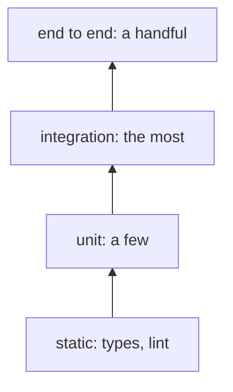

# 🏆 testing-trophy

[📚 Docs home](../../../../docs/README.md) › [arnaud-zg](../../README.md) › **🏆 testing-trophy**

A skill that plans, writes and audits tests by Kent C. Dodds'
[testing trophy](https://kentcdodds.com/blog/the-testing-trophy-and-testing-classifications): static
checks, a few unit tests, mostly integration tests, a few end to end. A script counts the tests per
layer and flags what bends the shape.

**4 layers** · **5 rules** · **3 verbs** · **0 writes by the check**

## At a glance

- **What is it?** Three verbs, plan, write and audit, and a check that reads test file names
- **When is it used?** Only where a project chooses it, for example in its `CLAUDE.md`
- **How do I install it?** `/plugin install arnaud-zg --marketplace arnaud-zg/skills`, or
  `npx skills add arnaud-zg/skills --skill testing-trophy`
- **How do I call it?** Ask Claude to _write the tests_, _audit the tests_ or _use the testing
  trophy_, or type `/arnaud-zg:testing-trophy`
- **What does it need?** Node 22 for the check. No network, no dependency

## Which page do I need?

| If you want to…                  | Go to                            | It gives you                         |
| -------------------------------- | -------------------------------- | ------------------------------------ |
| check a first suite              | 🚀 [Tutorial](tutorial.md)       | a suite counted and checked          |
| plan, write, or fix one finding  | 🛠️ [How-to guides](how-to.md)    | one recipe per task                  |
| look up the layers and the rules | 📖 [Reference](reference.md)     | file names, rules, exit codes        |
| understand why integration wins  | 💡 [Explanation](explanation.md) | why this shape, and why names matter |

## 🔒 Know what you're installing

The check reads test files and config names under one folder and prints its findings. It writes
nothing, and has no network and no dependency. Read
[`SKILL.md`](../../skills/testing-trophy/SKILL.md) before installing it.
