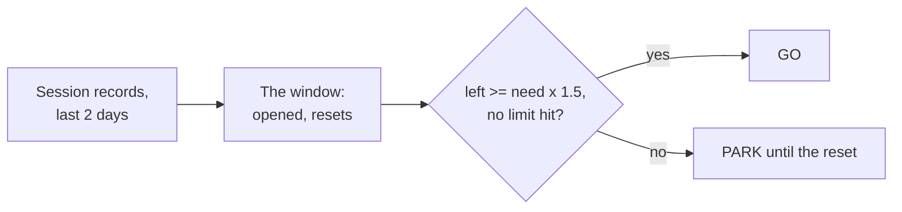

# ⏳ usage-runway

[📚 Docs home](../../../../docs/README.md) › [arnaud-zg](../../README.md) › **⏳ usage-runway**

A skill that tells you how much of Claude Code's usage window is left, when it resets, and whether
the next piece of work fits before it does, in one word: **GO** or **PARK**. It answers from the
clock and from any limit already hit, and never guesses a token ceiling.

**1 command** · **1 word back** · **5h window** · **x 1.5 margin**



## At a glance

- **What is it?** A meter Claude runs before a long piece of work, ending on GO or PARK
- **What does it print?**

  ```text
  credit · 5h window opened 19:26 · 660 turns
    burned    4.0M billed  (measured)
    resets    00:26 · 3h49 left  (projected from the window start)
    GO  3h49 of window against 45m needed
  ```

  One real reading, trimmed; yours will differ.

- **How do I install it?** `/plugin install arnaud-zg --marketplace arnaud-zg/skills`, or
  `npx skills add arnaud-zg/skills --skill usage-runway` for any agent
- **How do I call it?** Ask _do we have enough credit?_, or type `/arnaud-zg:usage-runway`
- **Who else calls it?** [skill-retro](../skill-retro/README.md) can ask it for GO or PARK before a
  long retro
- **What does it need?** Claude Code and Node.js. Nothing to configure

## Which page do I need?

| If you want to…                    | Go to                            | It gives you                    |
| ---------------------------------- | -------------------------------- | ------------------------------- |
| get a first verdict                | 🚀 [Tutorial](tutorial.md)       | one reading, from install to GO |
| size a job, park, feed a script    | 🛠️ [How-to guides](how-to.md)    | one recipe per task             |
| look up flags, fields and verdicts | 📖 [Reference](reference.md)     | every flag, line and JSON field |
| understand why it trusts the clock | 💡 [Explanation](explanation.md) | why no token ceiling, why x 1.5 |

## 🔒 Know what you're installing

- **It reads, and writes nothing.** `scripts/credit.mjs` reads the session records Claude Code keeps
  under `~/.claude/projects/` and prints a report. No network, no dependency.
- **It never waits for you.** It prints the reset time; parking is the caller's to do.

Read [`SKILL.md`](../../skills/usage-runway/SKILL.md) before installing it. Claude reads `SKILL.md`,
not this page.
