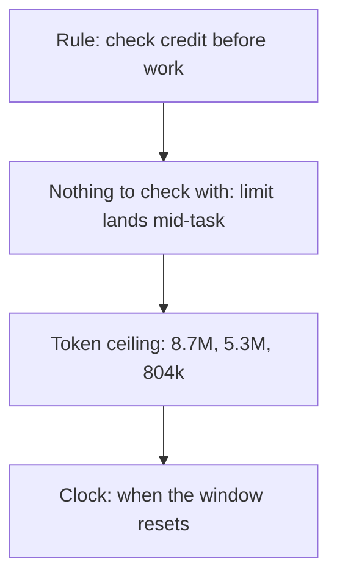

# 💡 Explanation: why the clock, not a token ceiling

[📚 Docs home](../../../../docs/README.md) › [⏳ usage-runway](README.md) ›
[🚀 Tutorial](tutorial.md) · [🛠️ How-to](how-to.md) · [📖 Reference](reference.md) · **💡
Explanation**

Why the skill works the way it does. To get something done, see the [How-to guides](how-to.md).

**The meter answers from the clock, because the token ceiling spread elevenfold.**

## A rule nobody can follow is not a rule

Long work had always been told to check its credit before starting a unit it could not finish, and
there was nothing to check it with. So the check was skipped and a limit landed mid-plan. The meter
is one command and one word, so the rule can be kept.

## A ceiling that spread elevenfold is not one to park on

Nothing on disk publishes the account's limit. Ceilings derived from three past limit hits read
8.7M, 5.3M and about 804k, and one window burned 11.4M with no limit at all. So burn is printed for
reading, and the verdict comes from the reset time, which is exact when a limit was hit.

## The window is not "the last five hours"

The first version anchored the window at the oldest turn of the last five hours, and told a session
with four hours left to park at once. A rolling window opens on the first turn after five idle hours
and advances in whole windows from there.

## A limit may land between units, never inside one

An estimate is what the work should take; the x 1.5 margin is what it takes when something goes
wrong. Checking before every unit, with that margin, puts the limit at a boundary.
