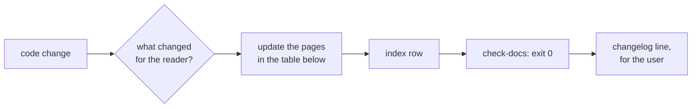

# Keep the docs true after a change

**The docs change in the same commit as the code they describe.** A doc fix left for later is a doc
that drifts (why: E-06).

## What to update

| The change…                                       | Update                                                      |
| ------------------------------------------------- | ----------------------------------------------------------- |
| adds or changes a command, flag, field or default | 📖 Reference row, read from the code that defines it        |
| adds a task a user can now do                     | 🛠️ How-to section, and its line in the list at the top      |
| changes the first-run path                        | 🚀 Tutorial step, and its "You should see", from a real run |
| makes a design choice                             | a new ADR, linked from 💡 Explanation                       |
| reverses a design choice                          | a new ADR that supersedes the old one, linked both ways     |
| removes a feature                                 | delete its rows and sections; the Explanation says why      |
| moves or renames a page                           | a gravestone if anything cites the old path, else delete it |
| changes what a generated page is built from       | regenerate it in the same commit                            |
| changes nothing a reader sees                     | nothing, and say so                                         |

Find what the change touches before writing: search the docs for every name the change renames or
removes, and update each hit. Say how many places changed.

## How to update

1. **Rewrite the page, never annotate it.** No "Updated in v2" callouts, no "it said X until". The
   page says what is true now, and the history lives in the CHANGELOG and the ADRs (why: E-03).
2. **When the code and the docs disagree, say so before fixing either.** Ask which one is right if
   the change does not settle it. Never let them diverge without a word.
3. **A decided ADR is never edited**, except its status line when a newer one supersedes it.
4. **Every number names where it came from**: the command that printed it, or the file that holds
   it. A count from memory is cut (why: E-08).
5. **Write the changelog line for the person using the code**: what they can do now, not what the
   code does.

Then run the check, and stop at exit 0.

## Gaps too big for one change

When a project has more stale pages than one change can fix, do not let the check stay red. Record
the count the check prints today in the index as a baseline, and make every later change lower it,
never raise it.
