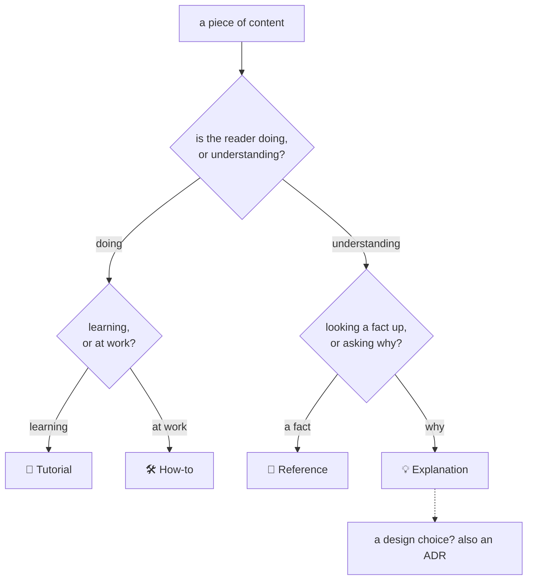

# Place content in a quadrant

Ask two questions about the reader, never about the content:

## Tell-tale signs

| The content…                                        | Goes to        | Not to                      |
| --------------------------------------------------- | -------------- | --------------------------- |
| walks a newcomer through one run, start to finish   | 🚀 Tutorial    | How-to: it assumes no goal  |
| says how to do one thing someone already wants      | 🛠️ How-to      | Tutorial: it has a goal     |
| lists commands, flags, fields, defaults, exit codes | 📖 Reference   | How-to: nobody follows it   |
| gives a table of states, errors or limits           | 📖 Reference   | Explanation                 |
| says why, compares alternatives, tells the history  | 💡 Explanation | Reference: it argues        |
| records a choice that was made, and when            | 🧭 ADR         | Explanation alone: it dates |
| says what changed in a release, for a user          | CHANGELOG      | any page (why: E-03)        |
| is about to explain while giving steps              | split it       | one page                    |

## When content fits two

Split it, then link the halves. A step list with a paragraph of reasoning becomes a how-to that
links "Why: see Explanation" to a section holding the paragraph. A reference table with advice under
each row keeps the table, and the advice moves to the how-to that needs it (why: E-04).

## What is not Diataxis

The index, a gravestone, a CHANGELOG and decision records sit beside the four quadrants. Each has
its template in `templates/` (the CHANGELOG is written by the release tool), and none of them
teaches, instructs or explains on its own.
