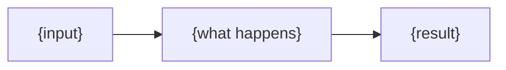

# 💡 Explanation: {product}

[🏠 Home](README.md) · [🚀 Tutorial](tutorial.md) · [🛠️ How-to](how-to.md) ·
[📖 Reference](reference.md) · **💡 Explanation**

Why it works the way it does. To get something done, see the [How-to guides](how-to.md).

<!-- Each heading states a principle as a sentence, then argues it. Name the alternatives and why
     they lost. A design choice worth recording gets an ADR, linked from here. -->

## {A principle, stated as a sentence}

{The reasoning. What it costs, what it buys, and what was tried first.}

## {Another principle}

{The reasoning.} Decided in [ADR-001](adr/ADR-001-record-architecture-decisions.md).

## Rules we dropped, and why

<!-- Keep this. A rule removed with its reason is not added back by the next person. -->

- **{rule}**: {why it was dropped, and what it cost while it lived}.
