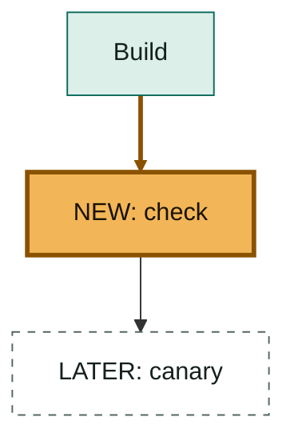

# Pictures

**One picture per block, chosen by the problem the block states, and drawn before the block's
words.** A picture is a Mermaid chart, a table, an image, or none. The first block always carries
one: it is what the eye lands on after the numbers. In a later block, if the line says it faster,
the picture is `none`. Put the figures in the picture itself (a bar's value, a row's count, an
arrow's `12 → 3`), so the picture reads without its line. The check refuses a picture the target
cannot draw.

## Pick by the problem

| The block says                                 | Picture           | Shape                                   |
| ---------------------------------------------- | ----------------- | --------------------------------------- |
| what changes (a proposal, a refactor)          | `flowchart TB`    | two stacked lanes, before above after   |
| what happens in order (an incident, a release) | `flowchart LR`    | 3 boxes, the failing one last           |
| how the parts fit, and which one changed       | `flowchart TB`    | stacked lanes: exists today, new, later |
| who talks to whom (a protocol, a handoff)      | `sequenceDiagram` | 3 actors at most                        |
| when things happen (a rollout, a timeline)     | `timeline`        | one line per date                       |
| which option wins (a decision)                 | `quadrantChart`   | value against effort, 3 options         |
| how a total splits (a budget, a score)         | `pie`             | 5 slices at most                        |
| a trend with real numbers                      | `xychart-beta`    | one series, labelled axes               |
| checks and their status, or any list of facts  | table             | 3 columns at most                       |
| what a screen looks like, before and after     | image             | one screenshot, with alt text           |

## Writing a chart

- Labels of 6 words at most. Quote a label that holds punctuation: `a["Build: check passes"]`.
- `flowchart LR` holds 5 nodes at most; anything larger is `flowchart TB`, with stacked lanes and
  every arrow drawn downward. A chart wider than the page is shrunk whole, text with it.

## An image

An image is a screenshot: `src` is the file or address, `alt` the words a screen reader says. It
takes the block it illustrates. If that block already carries a chart or a table, the image replaces
it, and the chart moves to a block whose picture was `none`, or is dropped if none is free.

## The three looks for what changed

Every picture that shows a change marks it, so the eye lands on it first. Three looks, each named in
words in the node or in a legend, never by colour alone:

| Look                 | Drawn as                  | Named as                         |
| -------------------- | ------------------------- | -------------------------------- |
| exists today         | green fill, solid border  | the plain label                  |
| new, or under review | amber fill, thick border  | `NEW:` or `REVIEW:` in the label |
| later                | white fill, dashed border | `LATER:` in the label            |

- `linkStyle` counts edges in the order they are written; thicken the arrows into the change.
- In a table, the changed row's first cell starts with `NEW:` or `REVIEW:`, and a later one with
  `LATER:`.
